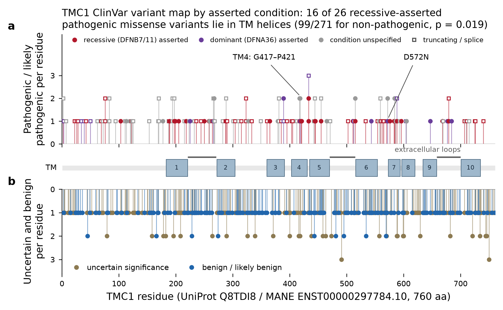
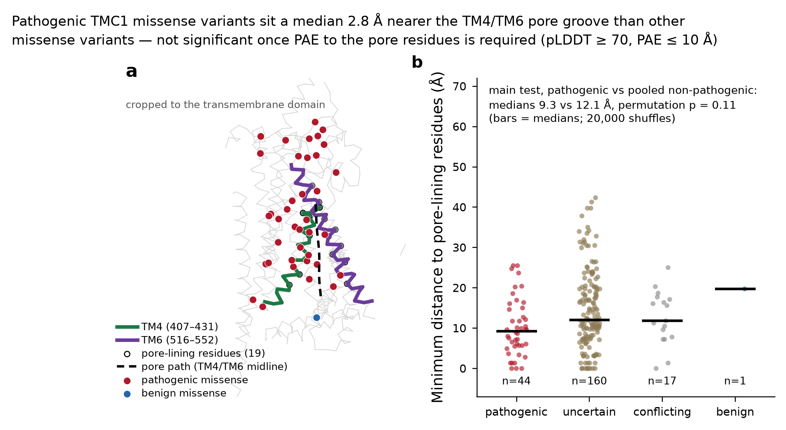

# Mapping hearing-loss variants onto TMC1 with Claude Science

> **DRAFT** — written with Claude Code; Andrew to edit into his own voice. Items marked **TODO** still need input.

A worked example of an end-to-end [Claude Science](https://claude.com/product/claude-science) workflow on public
data only. I asked where the clinically reported missense variants in **TMC1** fall on the protein. TMC1 is the
pore-forming subunit of the inner-ear hair-cell mechanotransduction channel. The questions were whether pathogenic
variants concentrate in the transmembrane helices, and whether they sit closer to the putative pore.

My PhD was in auditory neuroscience and ion-channel biophysics, so I could check each step against what I know
about the biology. That's the point of this write-up: what an AI research workbench got right, where it went wrong,
and what it took to get a result I'd stand behind.

## TL;DR

- **Recessive pathogenic missense variants are enriched in the TM helices.** 17 of 26 recessive (DFNB7/11) pathogenic
  missense variants fall in helices, against 91 of 271 other missense variants (OR 3.74, Fisher p = 0.0022), using
  helix boundaries from the *C. elegans* TMC-1 cryo-EM structure. This is **exploratory**: I split out the recessive
  subset after seeing the pooled result.
- **The distance-to-pore hypothesis did not hold up.** Pathogenic variants sit a median 2.8 Å nearer the pore
  groove (p = 0.11). Depending on how strictly AlphaFold's confidence is filtered, p ranges from 0.006 to 0.11, so I
  don't report it as a finding.
- **It reproduces.** The [notebook](notebooks/tmc1_variant_map_analysis.ipynb) rebuilds the result tables from six
  public APIs. Re-run in a clean environment, it produced files byte-for-byte identical to the originals.



## Data

| Source | Used for |
|---|---|
| gnomAD GraphQL (ClinVar mirror, 2026-09-28 snapshot; gnomAD r4) | 845 ClinVar variants, review status, allele frequencies |
| NCBI E-utilities (live ClinVar) | Asserted conditions → dominant (DFNA36) vs recessive (DFNB7/11) |
| Ensembl REST | MANE transcript ENST00000297784.10: CDS map and sequence |
| UniProt Q8TDI8 | Canonical sequence (760 aa), annotated TM topology |
| AlphaFold DB (AF-Q8TDI8-F1 v6) | Predicted structure, pLDDT, PAE |
| RCSB PDB 7USW | *C. elegans* TMC-1 complex, cryo-EM, 3.1 Å |

Claude Science derived protein positions itself: it mapped genomic positions to codons on the MANE transcript and
asserted that the translated CDS matches UniProt exactly. Results: 596 of 845 variants fall in coding sequence;
319 are missense, 48 of them pathogenic/likely pathogenic.

## Workflow

Prompts are in [`prompts.md`](prompts.md). Over one session:

1. **Plan and data pull.** ClinVar via gnomAD's mirror, codon-level mapping, UniProt topology, a first variant map.
2. **Correction.** I found consequence calls from the wrong transcript (below); Claude Science re-derived every
   consequence on MANE.
3. **Inheritance split.** After I enabled ClinVar access, it pulled live conditions for all 845 variants and split
   pathogenic missense into recessive (26), dominant (3), both asserted (6) and generic-only (13).
4. **Structure.** It superposed the AlphaFold model on 7USW (TM-score 0.76), compared helix boundaries, defined
   pore-lining residues, and computed each residue's distance to the pore and PAE.
5. **Correction.** I pushed back on the first pore-distance result (below). It switched to medians, added PAE
   filtering, sensitivity analysis and a pooled comparator, and re-ran the TM test with cryo-EM boundaries.
6. **Export.** At my request it wrote a single end-to-end notebook, which I re-ran independently.

## Results

**TM-helix enrichment** ([`data/tmc1_tm_enrichment.csv`](data/tmc1_tm_enrichment.csv)):

| Helix definition | Comparison | In TM | OR | p |
|---|---|---|---|---|
| UniProt | P/LP vs all other missense | 25/48 vs 99/271 | 1.89 | 0.053 |
| UniProt | Recessive P/LP vs all other missense | 16/26 vs 99/271 | 2.78 | 0.019 |
| Cryo-EM | P/LP vs all other missense | 23/48 vs 91/271 | 1.82 | 0.072 |
| Cryo-EM | **Recessive P/LP vs all other missense** | **17/26 vs 91/271** | **3.74** | **0.0022** |
| Cryo-EM | P/LP vs benign | 23/48 vs 0/4 | ∞ | 0.12 |

The 9 variants with any dominant (DFNA36) assertion show no helix preference (4/9 under UniProt ranges, p = 0.73).
One observation, n = 3, not a finding: each dominant-only variant sits just outside the cryo-EM helices.
M418K is in the TM4 break (418–419), D543N in the TM6 break (541–543), and D572N one residue before TM7.
UniProt's continuous helices count the first two as in-helix. **TODO (Andrew):** is this biologically plausible?

**Distance to the pore** ([`data/tmc1_pore_distance_sensitivity.csv`](data/tmc1_pore_distance_sensitivity.csv)),
pathogenic vs all other missense, medians, 20,000-shuffle permutation test:

| Filter | n (P/LP vs other) | Medians (Å) | p |
|---|---|---|---|
| pLDDT ≥ 70 | 48 vs 223 | 9.6 vs 16.7 | 0.006 |
| + PAE ≤ 15 Å | 46 vs 202 | 9.6 vs 14.7 | 0.038 |
| + PAE ≤ 12 Å | 45 vs 189 | 9.6 vs 13.3 | 0.089 |
| + PAE ≤ 10 Å | 44 vs 178 | 9.3 vs 12.1 | 0.11 |
| + PAE ≤ 8 Å | 38 vs 153 | 7.8 vs 11.3 | 0.026 |



**Structural detail worth knowing:** UniProt annotates TM1, TM4 and TM6 as continuous helices. In the cryo-EM
structure each is two helices with a short break, at 207–210, 418–419 and 541–543
([`data/tmc1_topology_comparison.csv`](data/tmc1_topology_comparison.csv)). The TM4 break falls at M418, a residue
with pathogenic variants (M418K, M418T). **TODO (verify):** human M418 should align with M412 in the *Beethoven*
mouse (Tmc1 p.M412K).

## Where I had to step in

1. **Consequences from the wrong transcript.** The first pass reported that no benign missense variant sits in a
   TM helix (25/0 vs 23/6, p = 0.025, "a real signal"). Two of the six "benign missense" variants weren't missense
   on the MANE transcript: p.A755A is synonymous and p.\*761\* is stop-retained. The labels came from the gnomAD
   mirror's off-transcript call. With the four real ones, p = 0.11. Re-deriving every consequence turned up 9 such
   rows, including 5 variants in the 3′UTR labeled missense.
2. **A headline driven by one outlier.** The first pore-distance figure said "35.6 Å closer, p = 0.008". That was a
   difference of **means** plotted over **median** bars, driven by p.K65E at 98.7 Å. K65E is in the N-terminal
   domain, where AlphaFold is confident locally (pLDDT 73) but not about where the domain sits relative to the pore.
   That uncertainty shows up in PAE, which pLDDT filtering ignores. The benign comparison group was also only 3
   variants.
3. **Pore definition.** I asked for pore-lining residues across TM4–TM7, by homology to TMEM16/OSCA. The first pass
   used TM4 and TM6 only. The corrected version tests all four helices with one rule. TM5 and TM7 still contribute
   almost nothing, but see Limitations.

The analysis Claude Science produced after each correction was careful. It added the sensitivity sweep unprompted,
and it wrote "not significant" into the figure title itself.

## What the reviewer caught

Claude Science's background reviewer re-reads each response against the execution record. By design it checks
whether claims match what ran, not whether the method was the right choice.

It caught two real problems, both small and both easy for a human reader to skim past:

1. **Notebook narration vs output.** A markdown cell said "four rows disagree, including two 3′UTR positions", while
   the executed output directly below listed nine, five of them 3′UTR.
2. **An off-by-one in the topology verdict.** The table said UniProt's TM6 end (553) "matches the second piece" of
   the cryo-EM helix, but the same row gives that piece as 544–552. The claim was right for the AlphaFold model
   (544–553) and wrong by one residue for the cryo-EM structure. Claude repeated the claim in its chat summary too.

Both are exactly what the reviewer is built for: a stated claim that contradicts the record. I corrected both by
hand in the published files (the notebook sentence and the CSV verdict text); no code or numbers changed.

It did not flag the three issues above, and by its own design it shouldn't. Those weren't claims that contradicted
the execution record. They were judgment calls about data and method: which transcript defines "missense", whether a
mean or a median is the honest summary, and what counts as the pore. The two kinds of checking turned out to be
complementary. The reviewer catches the narrative drifting away from what actually ran. Domain review catches
analyses that ran exactly as written and were still wrong.

**TODO (Andrew):** add any other reviewer cards from the session.

## Reproducibility

- [`notebooks/tmc1_variant_map_analysis.ipynb`](notebooks/tmc1_variant_map_analysis.ipynb) runs end to end against
  public APIs, no Claude Science needed (Python 3.11; numpy, pandas, scipy, matplotlib, biotite). Running it in a
  clean environment reproduced `tmc1_clinvar_variant_map.csv`, `tmc1_tm_enrichment.csv` and
  `tmc1_pore_distance_sensitivity.csv` byte-for-byte. Set `NCBI_EMAIL` to pass a contact email to NCBI.
- Both ClinVar sources change over time. A later run will shift counts.
- **About the tool's own export:** Claude Science records provenance for every artifact (code, execution log,
  environment) and can export it as a script or notebook. In this long session, the export for the pore figure came
  back incomplete. The rebuild of earlier steps failed (`reconstruction failed validation (max_tokens)`), so the
  bundle held only the final plotting cell. Asking Claude Science for one consolidated notebook gave a complete,
  verifiable replacement.
- [`history/`](history/) keeps the outputs from earlier runs, before each correction.

## Limitations

- **ClinVar bias.** Benign missense variants are rare here (4 total), so most comparisons use "all other missense",
  which includes VUS. Some of those VUS are likely pathogenic, which would bias results toward the null.
- **Inheritance labels are per variant, not per submission.** "Both asserted" means submitters disagreed.
  p.D572H is labeled only with generic conditions although it shares a codon with dominant p.D572N, so the dominant
  set is an undercount.
- **The pore model is a hypothesis.** The pore path is the TM4/TM6 midline. TM5 and TM7 residues are then judged
  by distance to that line, which builds in part of the conclusion.
- **AlphaFold is not an experimental structure.** The helix boundaries come from mapping a *C. elegans* structure
  onto the human model (TM-score 0.76, RMSD 7.5 Å over 591 Cα pairs).
- **Three multi-nucleotide variants** keep the mirror's missense label with no derived protein change (one is
  pathogenic).
- Research demo only. Not for clinical or diagnostic use.

## Repo layout

```
data/        final tables (variant map, enrichment, sensitivity, topology, pore residues)
figures/     final figures
notebooks/   end-to-end reproduction notebook (executed)
history/     outputs from runs 1-2, before corrections
prompts.md   the prompts used in Claude Science
```

## Data licenses

UniProt (CC BY 4.0), AlphaFold DB (CC BY 4.0), ClinVar (public domain), gnomAD (ODbL), RCSB PDB (CC0),
Ensembl (no restrictions). Analysis code and text in this repo: MIT. **TODO:** confirm the license choice.
